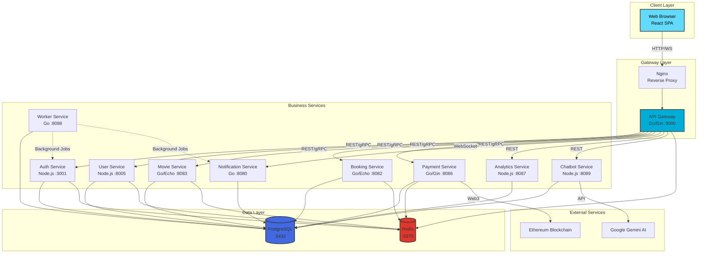

<div align="center">

# 🎬 Cinema Booking System

**Enterprise-grade microservices platform for cinema ticket booking and management**

[](LICENSE)
[](docker-compose.yml)
[](https://go.dev/)
[](https://nodejs.org/)
[](https://react.dev/)
[](https://www.postgresql.org/)

[Getting Started](docs/GETTING_STARTED.md) • [Architecture](docs/ARCHITECTURE.md) • [API Docs](docs/API.md) • [Contributing](docs/CONTRIBUTING.md)

</div>

---

## 📖 Introduction

The **Cinema Booking System** is a full-stack, production-ready platform built with modern microservices architecture. It enables seamless movie browsing, real-time seat selection, secure payment processing (including blockchain), and AI-powered customer support.

### Why This Project?

- **🎯 Real-world complexity**: Demonstrates enterprise patterns including microservices, event-driven architecture, and distributed transactions
- **🚀 Modern tech stack**: Combines Go's performance with Node.js flexibility, React's UI capabilities, and cutting-edge AI/blockchain integration
- **📚 Learning resource**: Comprehensive documentation and clean code structure make it ideal for studying system design
- **🔧 Production-ready**: Includes authentication, authorization, caching, monitoring, and deployment configurations

---

## ✨ Key Features

### For Customers

- **🎥 Movie Discovery**: Browse comprehensive movie catalog with detailed information, trailers, and ratings
- **🪑 Real-time Seat Selection**: Interactive seat map with instant availability updates
- **💳 Flexible Payments**: Support for traditional payment methods and Ethereum blockchain transactions
- **🔔 Live Notifications**: WebSocket-based real-time updates for bookings and payments
- **🤖 AI Chatbot**: Intelligent customer support powered by Google Gemini with RAG (Retrieval Augmented Generation)

### For Staff & Administrators

- **📊 Analytics Dashboard**: Revenue reports, booking statistics, and business insights with interactive charts
- **🎬 Content Management**: Manage movies, showtimes, rooms, and seat configurations
- **👥 User Management**: Role-based access control with granular permissions
- **📈 Performance Monitoring**: Real-time system health and service status tracking

### Technical Highlights

- **⚡ High Performance**: Go-based services with efficient gRPC inter-service communication
- **🔐 Enterprise Security**: JWT authentication, bcrypt password hashing, and RBAC authorization
- **📦 Microservices Architecture**: 10+ independent services for scalability and maintainability
- **🗄️ Advanced Database**: PostgreSQL with pgvector extension for AI embeddings
- **🔄 Event-Driven**: Outbox pattern for reliable asynchronous processing
- **🐳 Containerized**: Full Docker Compose setup for easy deployment

---

## 🏗️ Architecture Overview

The system follows a **microservices architecture** with clear separation of concerns. Each service is independently deployable, scalable, and maintainable.



### Service Responsibilities

| Service | Technology | Port | Responsibilities |
|---------|-----------|------|------------------|
| **API Gateway** | Go/Gin | 8000 | Request routing, authentication, rate limiting, CORS |
| **Auth Service** | Node.js/TypeScript | 3001 | User authentication, JWT generation, session management |
| **User Service** | Node.js/TypeScript | 8005 | User profiles, loyalty points, wallet management |
| **Movie Service** | Go/Echo | 8083 | Movie catalog, genres, showtimes, search |
| **Booking Service** | Go/Echo | 8082 | Ticket reservations, seat management, booking lifecycle |
| **Payment Service** | Go/Gin | 8086 | Payment processing, blockchain integration, refunds |
| **Notification Service** | Go | 8080 | Real-time WebSocket notifications, push messages |
| **Analytics Service** | Node.js/TypeScript | 8087 | Revenue reports, statistics, business intelligence |
| **Chatbot Service** | Node.js/TypeScript | 8089 | AI-powered support, RAG-based knowledge retrieval |
| **Worker Service** | Go | 8088 | Background jobs, event processing, scheduled tasks |

For detailed architecture documentation, see [docs/ARCHITECTURE.md](docs/ARCHITECTURE.md).

---

## 🚀 Hướng Dẫn Cài Đặt và Khởi Chạy (Quick Start Guide)

### 1. Yêu cầu hệ thống (Prerequisites)
- **Docker & Docker Desktop** (bắt buộc - đã bật và đang chạy)
- **Node.js** 18+ & **npm** (để chạy giao diện Frontend React)
- **Git** (nếu clone từ remote)

---

### 2. Cấu hình biến môi trường (.env)
Hệ thống microservices bao gồm nhiều dịch vụ độc lập. Dự án đã cấu hình sẵn các file `.env` chuẩn ở từng thư mục:
- `api-gateway/.env`
- `auth-service/.env`
- `user-service/.env`
- `movie-service/.env`
- `booking-service/.env`
- `payment-service/.env`
- `notification-service/.env`
- `analytics-service/.env`
- `worker-service/.env`
- `chatbot/.env`
- `FE/.env`
- `migrate/.env`

*(Nếu cần chỉnh sửa secret key, Gemini API key, hoặc cấu hình SMTP mail, bạn có thể chỉnh trực tiếp trong file `.env` của dịch vụ tương ứng).*

---

### 3. Khởi chạy Backend Services (Docker Compose)
Tại thư mục gốc của dự án (`cinema-project-main`), chạy lệnh sau để build và khởi động toàn bộ 10+ container backend:

```bash
docker compose up -d
```

> **Mẹo**: Nếu đây là lần đầu chạy hoặc bạn vừa cập nhật mã nguồn, hãy build image:
> ```bash
> docker compose up -d --build
> ```

Kiểm tra trạng thái các container đang chạy:
```bash
docker compose ps
```

---

### 4. Khởi tạo Database & Dữ liệu mẫu (Database Migration & Seeding)
Dự án đã tích hợp module migrate vào Docker Compose, không cần cài đặt Go trên máy host.

Chạy lệnh sau để tạo toàn bộ bảng (PostgreSQL + pgvector) và nạp sẵn dữ liệu mẫu (danh mục phim, rạp, ghế, tài khoản người dùng, suất chiếu...):

```bash
# Cách 1: Chạy qua Docker Compose (Khuyên dùng - không cần cài Go)
docker compose --profile tools run --rm migrate reset

# Cách 2: Nếu máy bạn đã cài Go 1.21+
cd migrate
go run main.go reset
cd ..
```
*Lưu ý*: Lệnh `reset` sẽ xóa bảng cũ (nếu có) và nạp lại toàn bộ dữ liệu seed mới nhất. Nếu chỉ muốn chạy các migration còn thiếu mà không xóa dữ liệu, dùng `up` thay cho `reset`.

---

### 5. Khởi chạy Giao diện Frontend (React SPA)
Frontend được đặt trong thư mục `FE`:

```bash
# 1. Di chuyển vào thư mục Frontend
cd FE

# 2. Cài đặt các thư viện phụ thuộc (nếu chưa cài)
npm install --legacy-peer-deps

# 3. Khởi chạy máy chủ phát triển
npm start
```
Frontend sẽ tự động mở hoặc truy cập trực tiếp tại: **[http://localhost:3000](http://localhost:3000)**.

---

### 6. Danh sách URL & Cổng truy cập (Access Points)

| Dịch vụ / Ứng dụng | Đường dẫn (URL) | Cổng | Chức năng chính |
|--------------------|-----------------|------|-----------------|
| **Frontend Web** | [http://localhost:3000](http://localhost:3000) | `3000` | Giao diện đặt vé, chọn ghế, quản lý rạp |
| **Nginx Proxy** | [http://localhost](http://localhost) | `80` | Reverse Proxy trỏ vào API Gateway & WebSocket |
| **API Gateway** | [http://localhost:8000](http://localhost:8000) | `8000` | Điểm tiếp nhận request tập trung cho backend |
| **Auth Service** | `http://localhost:3001` | `3001` | Đăng nhập, đăng ký, xác thực JWT |
| **User Service** | `http://localhost:8005` | `8005` | Thông tin người dùng, ví tiền, điểm thưởng |
| **Movie Service** | `http://localhost:8083` | `8083` | Quản lý phim, thể loại, phòng chiếu, ghế ngồi |
| **Booking Service** | `http://localhost:8082` | `8082` | Đặt vé, giữ chỗ, quản lý đơn đặt |
| **Payment Service** | `http://localhost:8086` | `8086` | Thanh toán hóa đơn, crypto/blockchain |
| **Notification Service** | `http://localhost:8080` | `8080` | WebSocket thông báo thời gian thực (`/ws`) |
| **Analytics Service** | `http://localhost:8087` | `8087` | Báo cáo doanh thu, phân tích dữ liệu |
| **AI Chatbot Service** | `http://localhost:8089` | `8089` | Trợ lý ảo AI hỏi đáp thông tin rạp phim |
| **PostgreSQL Database** | `localhost:5432` | `5432` | Database `cinema_app` (User: `postgres`, Pass: `postgres`) |
| **Redis Cache** | `localhost:6379` | `6379` | Bộ nhớ đệm cache và pub/sub |

---

### 7. Tài khoản đăng nhập mẫu (Demo Accounts)

Hệ thống đã nạp sẵn dữ liệu tài khoản để kiểm thử:

| Vai trò | Email đăng nhập | Mật khẩu | Ghi chú |
|---------|-----------------|----------|---------|
| **Khách hàng (Customer)** | `alice@email.com` | `password` | Dùng đăng nhập tại trang chủ người dùng |
| **Quản trị viên (Admin)** | `admin@cinema.com` | `password` | Toàn quyền quản trị hệ thống |
| **Quản lý rạp (Manager)** | `manager@cinema.com` | `password` | Quản lý phim, suất chiếu, phòng chiếu |
| **Nhân viên bán vé (Ticket Staff)** | `ticket@cinema.com` | `password` | Xuất vé và kiểm tra vé tại quầy |

---

### 8. Lệnh dừng hệ thống (Stop Services)
Khi muốn dừng hệ thống, mở terminal tại thư mục gốc và chạy:
```bash
docker compose down
```
Nếu muốn xóa sạch container và dữ liệu ổ đĩa volume (reset hoàn toàn):
```bash
docker compose down -v
```

---

## 📚 Documentation

Comprehensive documentation is available in the `docs/` directory:

| Document | Description |
|----------|-------------|
| [Getting Started](docs/GETTING_STARTED.md) | Installation, setup, and running instructions |
| [Architecture](docs/ARCHITECTURE.md) | System design, service interactions, and design patterns |
| [API Documentation](docs/API.md) | Complete API reference with examples |
| [Environment Configuration](docs/ENVIRONMENT.md) | Environment variables for all services |
| [Contributing](docs/CONTRIBUTING.md) | How to contribute to the project |
| [Roadmap](docs/ROADMAP.md) | Planned features and product vision |
| [Prerequisites](docs/PREREQUISITES.md) | System requirements and dependencies |

---

## 🛠️ Technology Stack

### Backend
- **Go 1.21+**: High-performance services (API Gateway, Movie, Booking, Payment, Notification, Worker)
- **Node.js 18+**: Business logic services (Auth, User, Analytics, Chatbot)
- **Frameworks**: Gin, Echo (Go), Express (Node.js)
- **ORMs**: Bun (Go), Sequelize (Node.js)

### Frontend
- **React 18**: Single-page application
- **React Router v6**: Client-side routing
- **Tailwind CSS**: Modern styling
- **Axios**: HTTP client
- **Ethers.js**: Blockchain integration
- **Recharts**: Analytics visualization

### Infrastructure
- **PostgreSQL 15**: Primary database with pgvector extension
- **Redis 7.4**: Caching and session management
- **Docker & Docker Compose**: Containerization
- **Nginx**: Reverse proxy and load balancing

### External Services
- **Google Gemini AI**: Chatbot intelligence
- **Ethereum**: Blockchain payments

---

## 🤝 Contributing

We welcome contributions! Please see our [Contributing Guidelines](docs/CONTRIBUTING.md) for details on:

- How to submit pull requests
- Code style guidelines
- Development setup
- Testing requirements

---

## 📄 License

This project is licensed under the **MIT License** - see the [LICENSE](LICENSE) file for details.

---

## 🗺️ Roadmap

See our [Product Roadmap](docs/ROADMAP.md) for planned features including:

- Mobile applications (iOS/Android)
- Payment gateway integrations (Stripe, PayPal)
- Multi-language support
- Kubernetes deployment
- Advanced AI features
- And much more!

---

## 🙏 Acknowledgments

Built with amazing open-source technologies:
[Go](https://go.dev/) • [Node.js](https://nodejs.org/) • [React](https://react.dev/) • [PostgreSQL](https://www.postgresql.org/) • [Redis](https://redis.io/) • [Docker](https://www.docker.com/)

---

<div align="center">

**Built with ❤️ by developers, for developers**

[⬆ Back to Top](#-cinema-booking-system)

</div>
